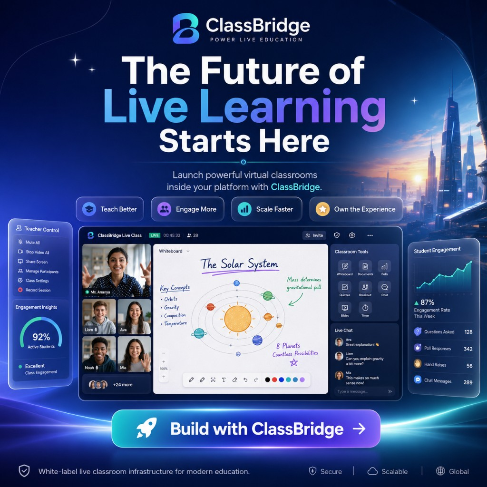
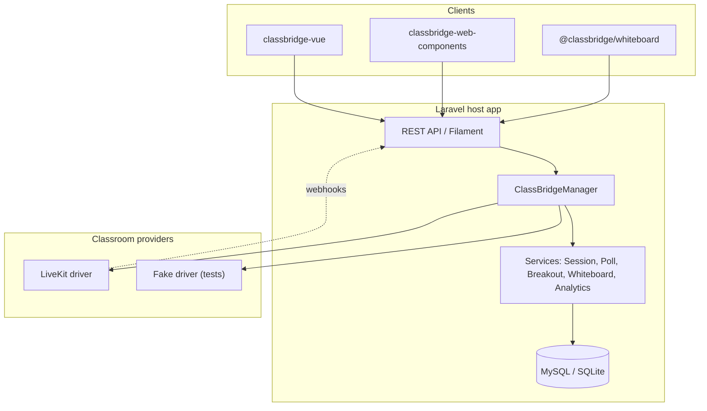
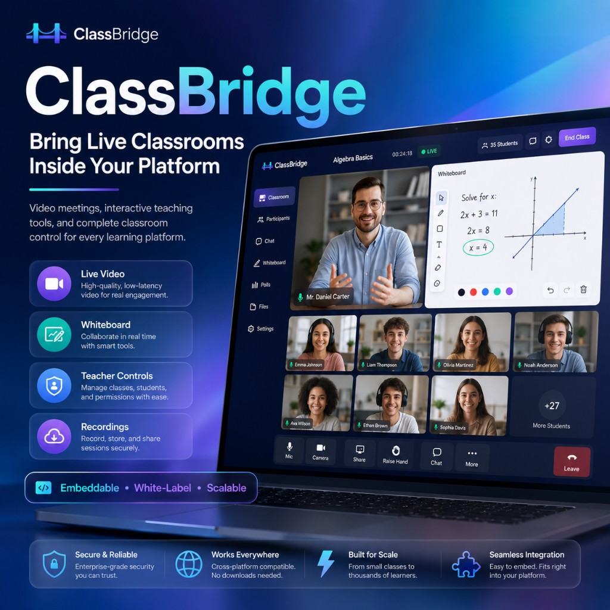
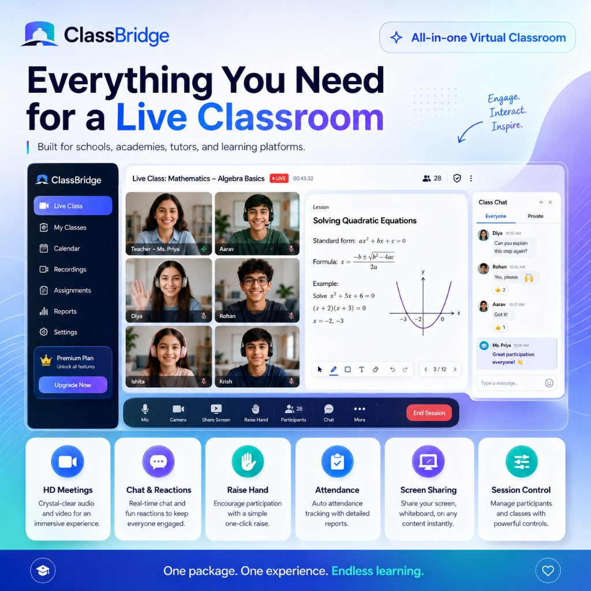
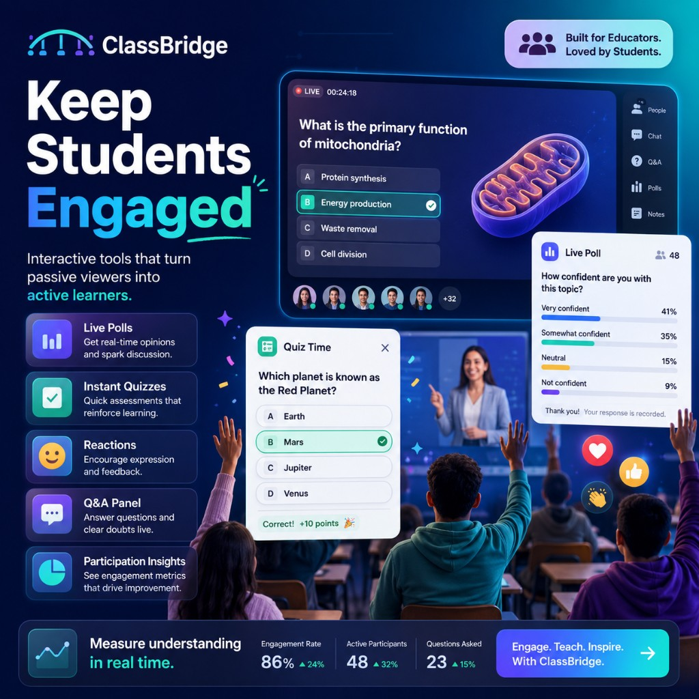
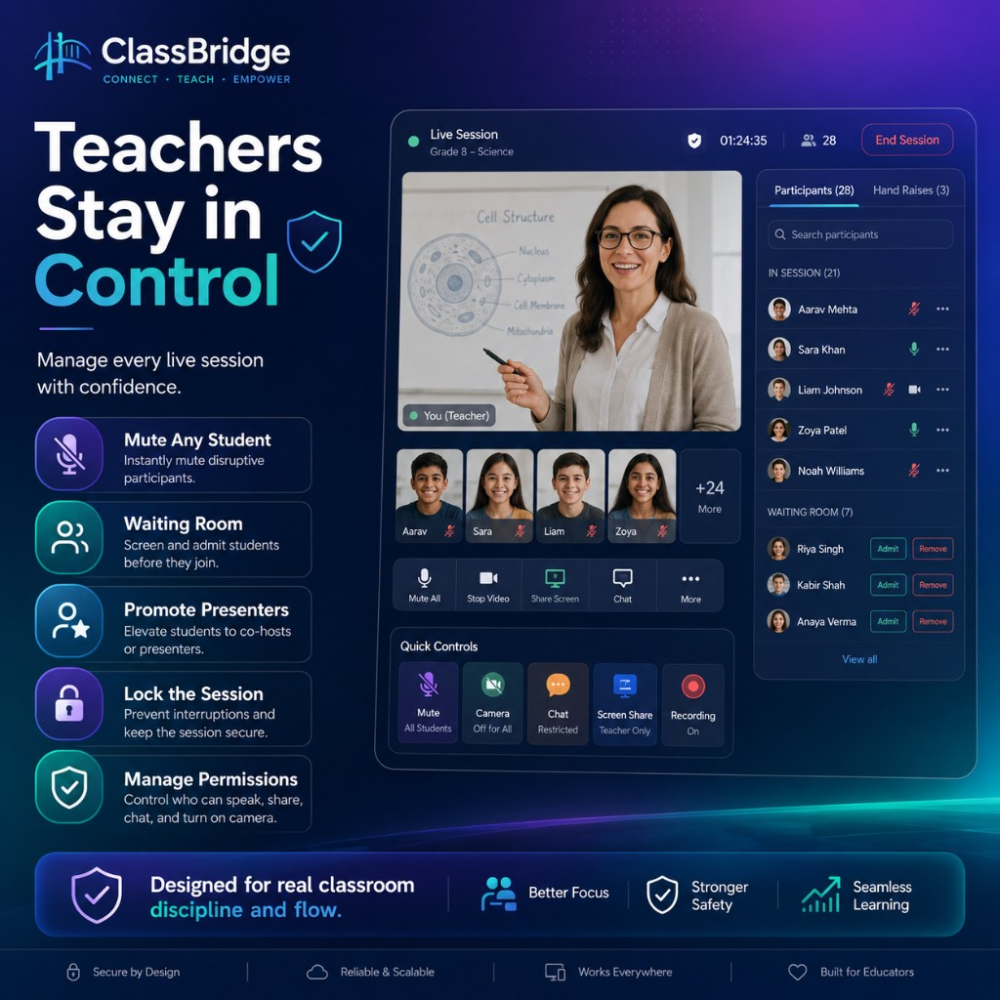
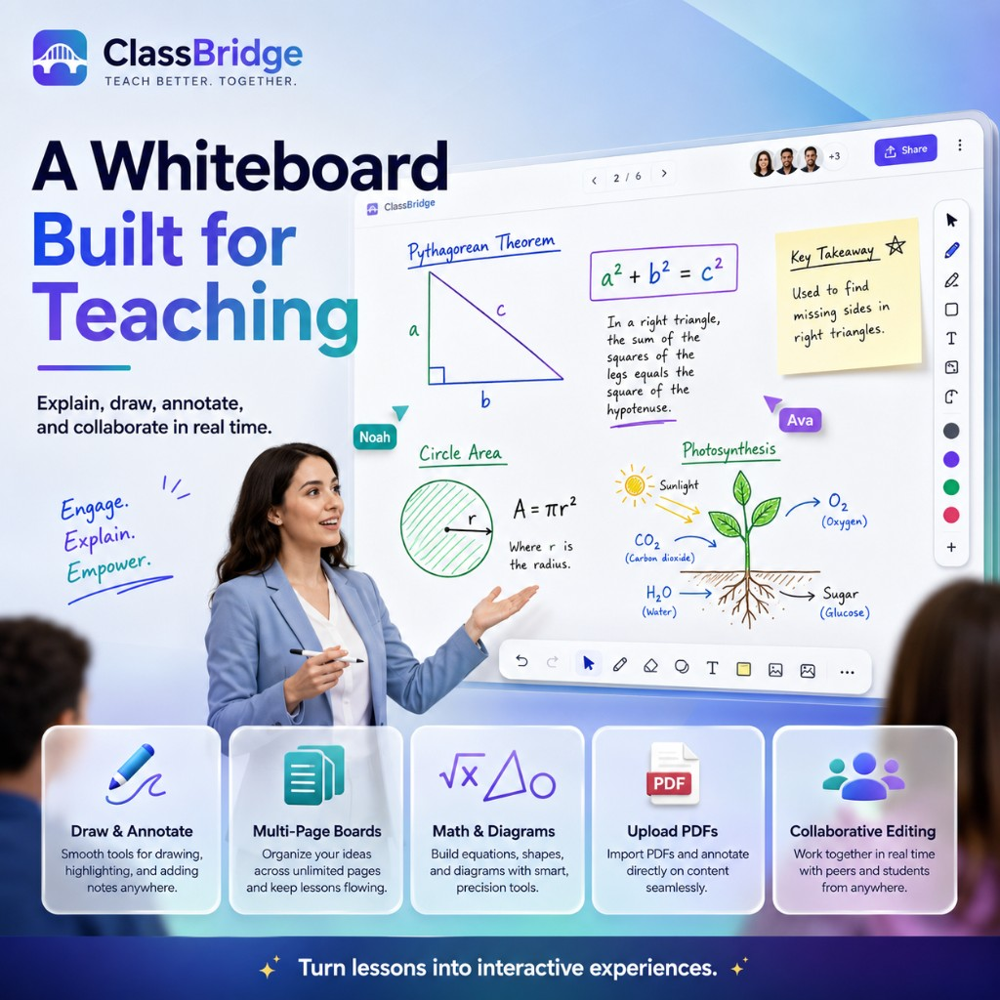
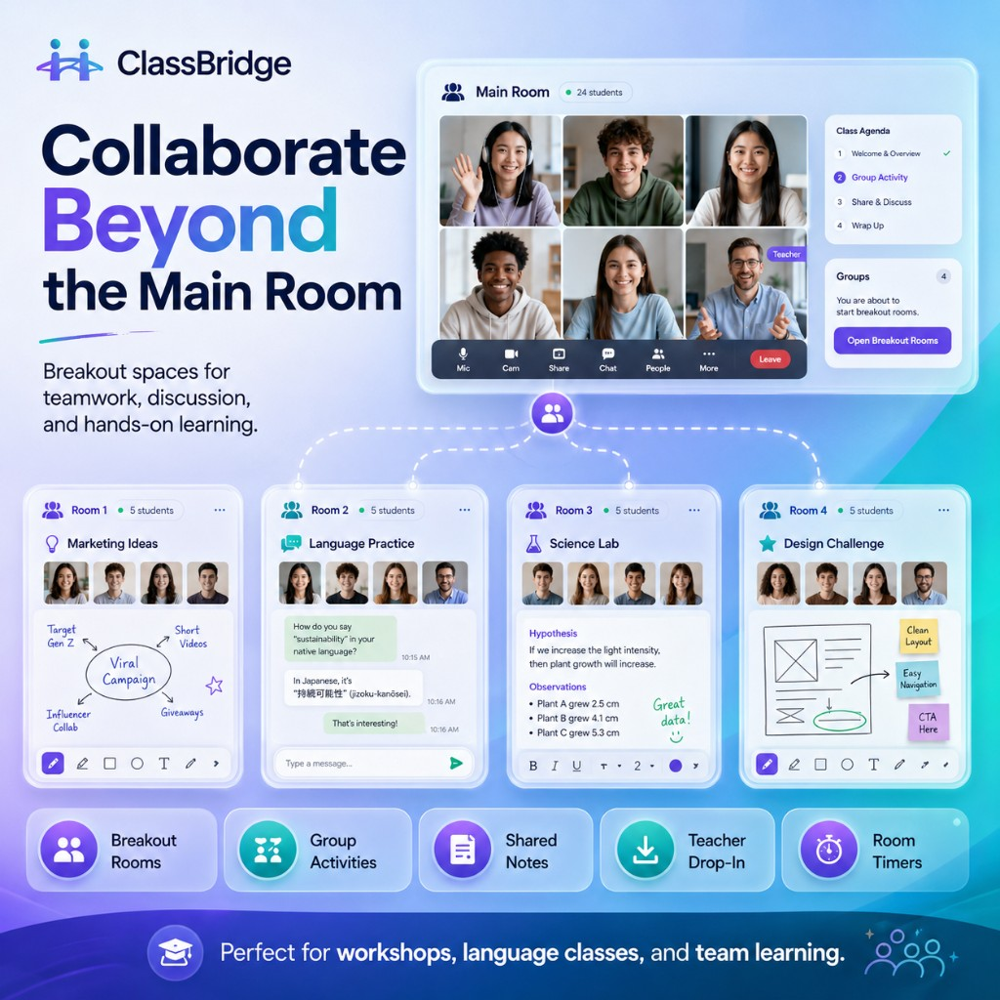
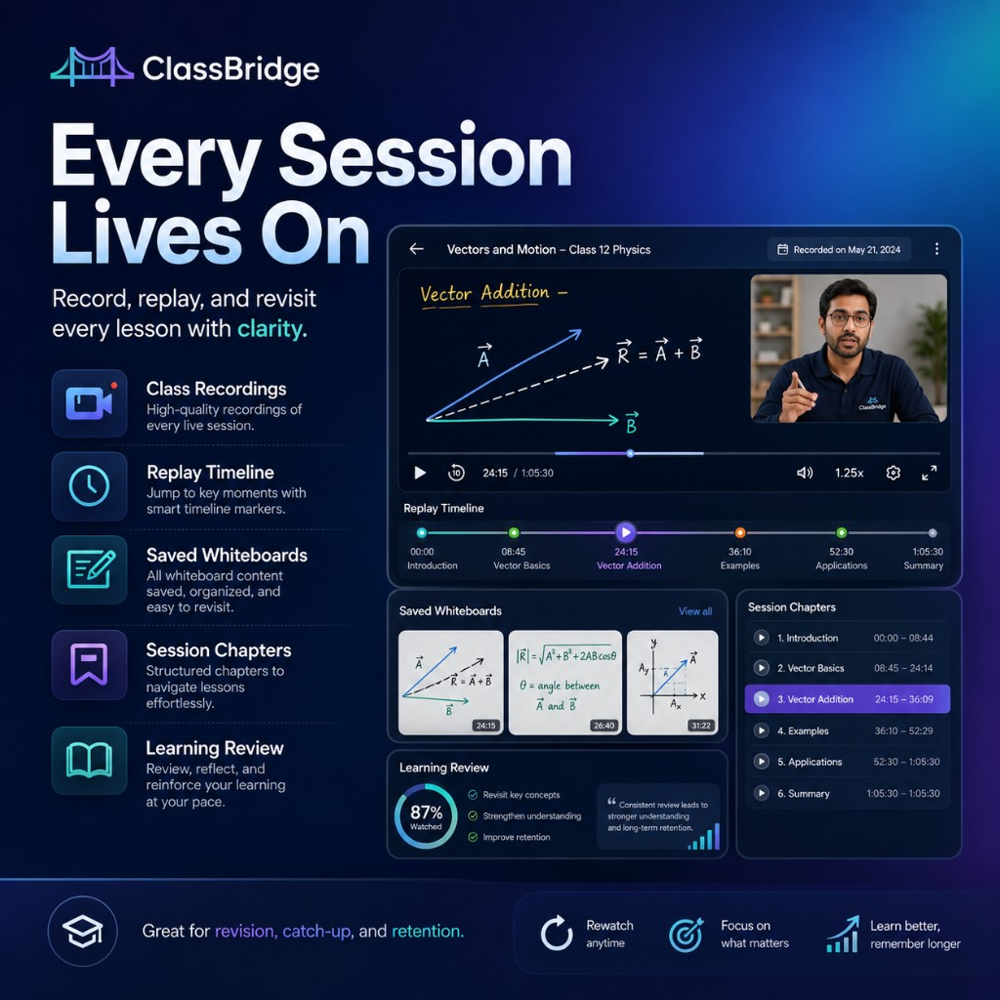

# ClassBridge

[](https://github.com/mohamedhekal/classbridge/actions)
[](LICENSE)
[](https://www.php.net/)
[](https://laravel.com/)

White-label live classroom orchestration for Laravel: sessions, waiting rooms, moderation, attendance, polls, breakouts, whiteboards, recordings, and provider abstraction.

Embeddable live classrooms for Laravel and modern education platforms — video meetings, teacher controls, whiteboards, attendance, recordings, polls, breakout rooms, and provider-based WebRTC integrations.

<p align="center">
  
</p>

## Installation

```bash
composer require mohamedhekal/classbridge
php artisan vendor:publish --tag=classbridge-config
php artisan vendor:publish --tag=classbridge-migrations
php artisan migrate
```

### LiveKit provider

```bash
composer require mohamedhekal/classbridge-livekit
```

Configure in `.env`:

```env
CLASSBRIDGE_DRIVER=livekit
LIVEKIT_URL=wss://your-livekit-host
LIVEKIT_API_KEY=...
LIVEKIT_API_SECRET=...
```

### Frontend packages (optional)

| Package | Purpose |
|---------|---------|
| `@classbridge/sdk` | TypeScript client for session events |
| `@classbridge/whiteboard` | Yjs collaborative whiteboard |
| `classbridge-vue` | Vue 3 classroom UI |
| `classbridge-web-components` | Framework-agnostic `<classbridge-room>` |

## Architecture



## Quick start

```php
use Hekal\ClassBridge\DTOs\CreateSessionData;
use Hekal\ClassBridge\Facades\ClassBridge;

$session = ClassBridge::forTenant('org-1')->session()->create(new CreateSessionData(
    title: 'Intro to Algebra',
    tenantId: 'org-1',
    teacherDisplayName: 'Ms. Smith',
    startsAt: now()->addHour(),
));

ClassBridge::session()->schedule($session, now()->addHour());
ClassBridge::session()->openWaiting($session);
ClassBridge::session()->start($session);

$poll = ClassBridge::polls()->createPoll($session, 'Ready to begin?', ['Yes', 'Not yet']);
ClassBridge::polls()->start($poll);

ClassBridge::session()->end($session);
```

Default driver is `fake` (in-memory). Register LiveKit or custom drivers via `ClassBridge::extend()`.

## Features

- Session lifecycle state machine (draft → scheduled → waiting → live → ended)
- Waiting room admit/reject flows
- Signed one-time join tokens
- Role-based moderation (mute, remove, lock, promote)
- Attendance rules and finalization
- Polls, Q&A, breakout rooms, collaborative whiteboards
- Session analytics summary
- Recording start/stop/publish via provider contract
- Multi-tenant session scoping
- Optional REST API under `api/classbridge`
- Optional iframe embed mode (`CLASSBRIDGE_EMBED=true`)
- Optional Filament admin stub (when Filament is installed)

## Documentation

- [Architecture](docs/architecture.md)
- [Integration guide](docs/integration.md)
- [Analytics](docs/analytics.md)
- [Embed mode](docs/embed.md)
- [Failure testing (LiveKit)](docs/failure-testing.md)
- [Basic example](examples/basic/README.md)

## Testing

```bash
composer test
composer analyse
composer format
```

## License

MIT © Mohamed Hekal

---

## Product Vision

ClassBridge brings live teaching, collaboration, engagement, and replay into
any education platform—without giving up its brand or learner experience.

<p align="center">
  
  
</p>

<p align="center">
  
  
</p>

<p align="center">
  
  
</p>

<p align="center">
  
  
</p>
